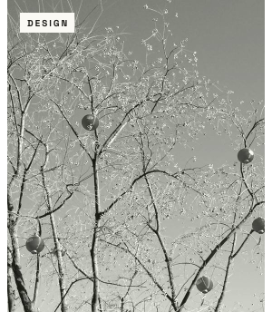
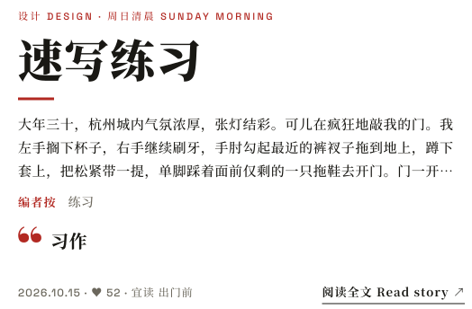
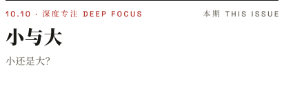
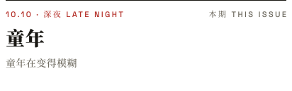
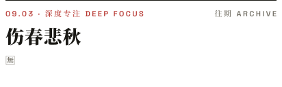
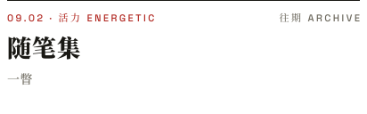
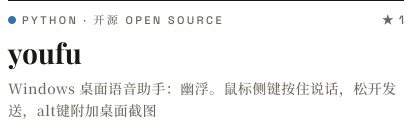
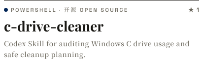

<!--
  星岛月报 · Starry Isle Monthly
  这个文件由 scripts/build.py 生成，GitHub Actions 每天重新排版一次。要改版面请改脚本，别直接改这里。
-->

<a href="https://wuyusblog.com"><picture><source media="(prefers-color-scheme: dark)" srcset="assets/masthead-dark.svg"></picture></a>

<picture><source media="(prefers-color-scheme: dark)" srcset="assets/motto-dark.svg"></picture>

<picture><source media="(prefers-color-scheme: dark)" srcset="assets/flag-01-dark.svg"></picture>

<a href="https://blog.wuyusblog.com/#/article/L5iAHz8Noj2wJKnRxSzZB"><picture><source media="(prefers-color-scheme: dark)" srcset="assets/photo-dark.svg"></picture></a><a href="https://blog.wuyusblog.com/#/article/L5iAHz8Noj2wJKnRxSzZB"><picture><source media="(prefers-color-scheme: dark)" srcset="assets/headline-dark.svg"></picture></a>

<picture><source media="(prefers-color-scheme: dark)" srcset="assets/flag-02-dark.svg"></picture>

<a href="https://blog.wuyusblog.com/#/article/OW5KViq4vweT2XYgBlouk"><picture><source media="(prefers-color-scheme: dark)" srcset="assets/brief-0-dark.svg"></picture></a><a href="https://blog.wuyusblog.com/#/article/MIL22cxwC6u90V2bJkmqd"><picture><source media="(prefers-color-scheme: dark)" srcset="assets/brief-1-dark.svg"></picture></a><a href="https://blog.wuyusblog.com/#/article/C2WhbnMbtJ84NujGMVEJI"><picture><source media="(prefers-color-scheme: dark)" srcset="assets/brief-2-dark.svg"></picture></a><a href="https://blog.wuyusblog.com/#/article/httpdBF91UmGHzEMJqKLW"><picture><source media="(prefers-color-scheme: dark)" srcset="assets/brief-3-dark.svg"></picture></a>

<picture><source media="(prefers-color-scheme: dark)" srcset="assets/flag-03-dark.svg"></picture>

<a href="https://wuyusblog.com"><picture><source media="(prefers-color-scheme: dark)" srcset="assets/isle-0-dark.svg"></picture></a><a href="https://portfolio.wuyusblog.com"><picture><source media="(prefers-color-scheme: dark)" srcset="assets/isle-1-dark.svg"></picture></a><a href="https://blog.wuyusblog.com"><picture><source media="(prefers-color-scheme: dark)" srcset="assets/isle-2-dark.svg"></picture></a>

<a href="https://github.com/blue-off-mind/youfu"><picture><source media="(prefers-color-scheme: dark)" srcset="assets/repo-0-dark.svg"></picture></a><a href="https://github.com/blue-off-mind/c-drive-cleaner"><picture><source media="(prefers-color-scheme: dark)" srcset="assets/repo-1-dark.svg"></picture></a>

源码 Source：<a href="https://github.com/blue-off-mind/shui-yu-huozi">碧水洗字 · shui-yu-huozi</a>

<picture><source media="(prefers-color-scheme: dark)" srcset="assets/flag-04-dark.svg"></picture>

<picture><source media="(prefers-color-scheme: dark)" srcset="https://raw.githubusercontent.com/blue-off-mind/blue-off-mind/output/snake-dark.svg"></picture>

<picture><source media="(prefers-color-scheme: dark)" srcset="assets/flag-05-dark.svg"></picture>

<a href="mailto:wuyuu0801@gmail.com"><picture><source media="(prefers-color-scheme: dark)" srcset="assets/letters-dark.svg"></picture></a>

本刊由 GitHub Actions 每日排版 · Typeset daily by GitHub Actions 
字体 Noto Serif SC · Playfair Display · Space Grotesk · 全部转成轮廓，所见即所印

